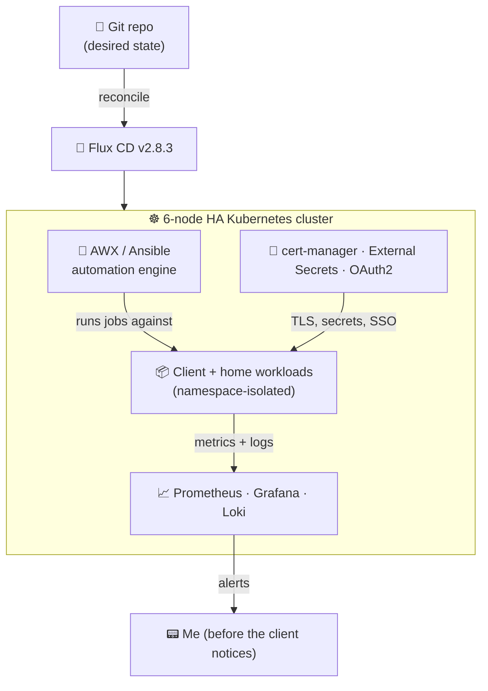

<h1 align="center">👋 Hi, I'm Riley Schuit</h1>

  <b>SRE / DevOps / Automation engineer.</b> I turn manual, error-prone work into infrastructure that runs itself. 
  I design self-service platforms, ship reliability (idempotency, monitoring, backups), and <b>treat documentation as a deliverable</b>. 
  <b>Open to full-time platform, SRE, and automation roles.</b>

  
  
  

  
  
  
  
  
  
  
  
  
  
  
  

---

## 🧭 Case study: I run a production-grade automation platform out of my house

Most "homelab" writeups are a screenshot of a Grafana dashboard. This is the real thing: a **6-node, high-availability Kubernetes cluster** that has been reconciling itself from Git and running around the clock since **April 2026** — no manual `kubectl apply`, no snowflake servers, nothing I can't rebuild from a repo.

I run it the way I'd run production at work: every change is a pull request, secrets come from an external store, every namespace is default-deny, and when something breaks I write down why.

The repos behind it are private because they describe my home network. I'm happy to walk through any of it on a call: [book 30 minutes](https://calendly.com/riley-schuit/30min).

---

## 🔨 Recent builds

- **AWS IoT device platform.** Serverless (SAM, Lambda, IoT Core, DynamoDB, S3, CloudFront). A containerized cloud compiler builds Arduino/ESP32 firmware per device, and updates go out over the air through the device shadow. I also wrote a device-management library for it: captive-portal setup, remote settings, and a hold-the-button network reset.
- **ESP32-S3 head tracker.** BNO085 sensor fusion to PPM trainer input on a FlySky NB4+, with double-tap recentering, tested end to end on the radio. It's managed and updated through the platform above. [Schematic and sketch](https://gist.github.com/rileyschuit/8e3f7a5ec94c87617974b9ce6fbb462b).
- **Live storage migration.** Moved about 10 stateful workloads (Prometheus, Grafana, Loki, Home Assistant, AdGuard DNS, a macOS VM) to a new NFS server. Each one got a new PersistentVolume instead of an edit to a bound one, after an in-place edit broke a full Flux apply. Along the way I wrote down the failure modes: export permissions, UID ownership, and `root_squash` for an init container that runs as root.
- **Finding my own blind spot.** After rolling out default-deny NetworkPolicies, an audit showed kube-state-metrics and the NFS prober had been quietly crash-looping, so the alerts that depended on them couldn't fire. I fixed the policies, then restored the missing heartbeat job in AWX config-as-code so it can't vanish again.
- **Early-warning monitoring.** One Grafana board with per-node disk-fill forecasts, read-only-root detection (an early sign of a failing NVMe), thermals, SMART disk health, and UniFi network health, all feeding Discord alerts tuned to cut noise.

---

## 📊 The cluster, by the numbers

| | |
|---|---|
| **Nodes** | 6 (3 control-plane HA + 3 workers), Calico CNI |
| **Workloads** | 60+ Deployments across 30+ namespaces |
| **Source of truth** | 100% GitOps — Flux CD `v2.8.3` reconciles every workload |
| **Automation engine** | AWX `24.6.1` (Ansible) on `awx-operator`, Postgres 15, NFS-persistent |
| **Observability** | Prometheus + Grafana + Loki/Promtail, node-exporter on every node |
| **Uptime** | Continuous operation since April 2026 |
| **Storage** | NFS + Unraid array, per-PVC capacity monitored |
| **Security** | cert-manager TLS, External Secrets, OAuth2 SSO, Trivy image scanning, Pod Security Standards |

---

## 🏗️ How it fits together

The pattern is boring on purpose: **desired state lives in Git, Flux makes reality match it, everything is observed, and secrets never touch the repo.** Boring is what "reliable" looks like in production.

---

<b>🔧 The full stack (click to expand — for the engineers)</b>

### GitOps & platform
- **Flux CD `v2.8.3`** — source, kustomize, helm, and notification controllers. Every namespace is labeled with its owning Flux Kustomization; drift is corrected automatically.
- **6-node cluster** — 3 HA control-plane nodes (etcd quorum) + 3 workers, **Calico** networking, CoreDNS, metrics-server.
- **Traefik** ingress with **cert-manager `v1.21.1`** issuing TLS automatically.

### Automation engine (the money-maker)
- **AWX `24.6.1`** via `awx-operator 2.19.1` — the open-source upstream of Ansible Automation Platform. Web + task + execution-environment pods, Redis, and a **Postgres 15** StatefulSet.
- **NFS-backed persistence** so the control database survives a total pod/node loss — documented in [`AWX-with-Persistent-Storage`](https://github.com/rileyschuit/AWX-with-Persistent-Storage).
- **AWX config-as-code** — job templates, schedules and credentials live in Git and reconcile nightly, so a database reinit can't silently delete a job.
- Client and product workloads deploy as **namespace-isolated** apps with their own secrets, dashboards, and network policy.

### Observability
- **Prometheus** (metrics) + **Grafana** (dashboards, incl. a single-pane "TLDR" board) + **Loki `3.0.0`** with **Promtail** log shipping on every node.
- **node-exporter** on all 6 nodes, **kube-state-metrics**, **blackbox-exporter** for synthetic HTTP probes, **pushgateway** for batch jobs.
- **Deploy-test canary** (being reworked) — a scheduled job deploys a throwaway workload to check the platform can still ship, not just that pods are green.
- **`nfs-prober`** DaemonSet checks the NFS mounts on every node, so a stale handle or stalled server shows up as an alert instead of a stuck app.

### Security & secrets
- **External Secrets Operator `v0.20.4`** — secrets are pulled from an external store at runtime; **nothing sensitive is ever committed to Git.**
- **Default-deny NetworkPolicies** in every namespace, with explicit egress per workload.
- **OAuth2 Proxy** SSO in front of internal apps, **Pod Security Standards** enforced (baseline/restricted), **Trivy** image vulnerability scans on a schedule.

### Modern touch: AI-operable infrastructure
- The cluster exposes itself to LLM agents over **MCP** (via ToolHive): GitHub, Grafana, Kubernetes, Unraid, and Home Assistant servers.
- Access is scoped, not open. Agents get namespaced RBAC with no wildcards, the public endpoint sits behind a path token and IP allow-list, and anything that can control the house is kept away from pods that have open internet egress.

---

## 💡 Hosting and products

Under **Sturgeon Technologies** I also host and operate automation for small businesses on this platform, and I'm building a few small products on top of it (the IoT platform above is one). Same rules as everything else: version-controlled, monitored, backed up, and handed over with a runbook so nobody is locked in.

**Hiring, or have a manual process eating your team's hours?** → [riley.schuit@gmail.com](mailto:riley.schuit@gmail.com) · [Book 30 minutes](https://calendly.com/riley-schuit/30min)

---

  <i>Container orchestration · GitOps · Ansible automation · observability · Linux · self-service platforms</i> 
  📫 <a href="mailto:riley.schuit@gmail.com">riley.schuit@gmail.com</a> &nbsp;·&nbsp; 📄 <a href="https://resume.rileyschuit.com">resume.rileyschuit.com</a>

